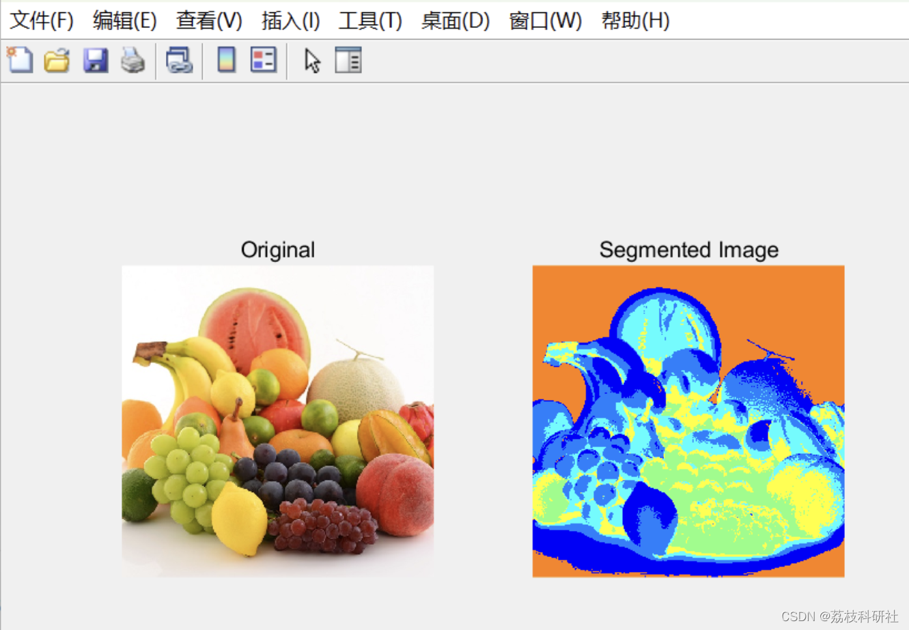
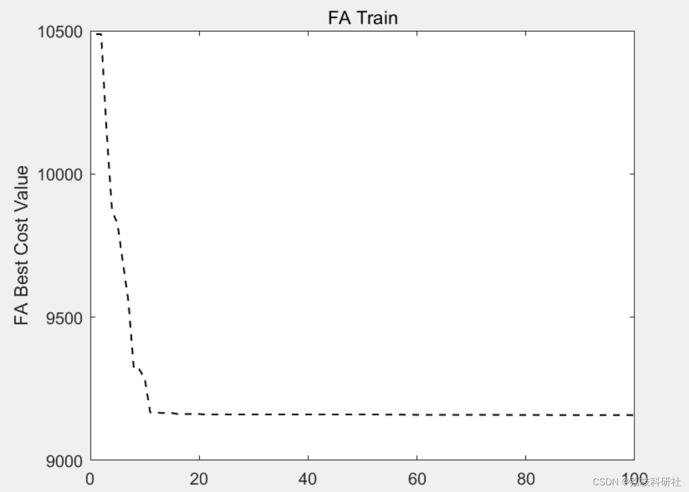

# Application of Image Segmentation Based on Improved Firefly Algorithm (Matlab Code Implementation)

🏆 Bloggers' Advantage: 🌞🌞🌞 The content of the blog is assiduously thought-provoking, logically clear, to facilitate readers.
⛳️ Mantra: A journey of a thousand miles begins with a single step.
📋📋📋 This article is organized as follows: 🎁🎁🎁 Table of Contents💥 1 Overview📚 2 Running Results🎉 3 References🌈 4 MATLAB Code for Implementation
​Edit💥 1 Overview Image segmentation divides an image into its constituent subregions or objects. The purpose of segmentation is to extract specific targets from complex images, which is an important basis for image recognition, image understanding, and image analysis. With the development of technology, image segmentation has been widely used in many fields, such as medical image processing, facial recognition, traffic road analysis, etc. The quality of segmentation directly affects the effectiveness of subsequent work. Therefore, more and more scholars are researching various related image segmentation algorithms, fuzzy theory can well describe the characteristics of images and has been deeply studied in image segmentation.
Firefly Algorithm is inspired by the group behavior of fireflies through bioluminescence for information exchange in nature. As a novel bio-inspired swarm intelligence optimization algorithm, it analyzes the biological principles of the Firefly Algorithm, and defines the optimization process from a mathematical perspective. Through typical function optimization and combinatorial optimization problems, the algorithm was tested, and the test results showed the feasibility and effectiveness of the Firefly Algorithm in continuous space and discrete space optimization, with good application prospects.
📚 2 Running Results
​Edit Part of the code:
%% Firefly Algorithm (FA) Image Segmentation Using Clustering
clear;
clc;
warning('off');
% Loading
img = imread('f.jpg');
img = im2double(img);
gray = rgb2gray(img);
gray = imadjust(gray);
% Reshaping image to vector  
X=gray(:);  
%% Starting FA Clustering  
k = 6; % Number of clusters  
%---------------------------------------------------  
CostFunction=@(m) ClusterCost(m, X);  % Cost Function  
VarSize=[k size(X,2)];     % Decision Variables Matrix Size  
nVar=prod(VarSize);       % Number of Decision Variables  
VarMin= repmat(min(X),k,1);   % Lower Bound of Variables  
VarMax= repmat(max(X),k,1);   % Upper Bound of Variables  
% Firefly Algorithm Parameters  
MaxIt = 100;    % Maximum Number of Iterations  
nPop = 10;      % Number of Fireflies (Swarm Size)  
gamma = 1;      % Light Absorption Coefficient  
beta0 = 2;      % Attraction Coefficient Base Value  
alpha = 0.2;     % Mutation Coefficient  
alpha_damp = 0.98;  % Mutation Coefficient Damping Ratio  
delta = 0.05*(VarMax-VarMin);  % Uniform Mutation Range  
m = 2;  
if isscalar(VarMin) && isscalar(VarMax)  
dmax = (VarMax-VarMin)*sqrt(nVar);  
else  
dmax = norm(VarMax-VarMin);  
end  
% Start  
% Empty Firefly Structure  
firefly.Position = [];  
firefly.Cost = [];  
firefly.Out = [];  
% Initialize Population Array  
pop = repmat(firefly, nPop, 1);  
% Initialize Best Solution Ever Found  
BestSol.Cost = inf;  
% Create Initial Fireflies  
for i = 1:nPop  
pop(i).Position = unifrnd(VarMin, VarMax, VarSize);  
[pop(i).Cost, pop(i).Out] = CostFunction(pop(i).Position);  
if pop(i).Cost <= BestSol.Cost  
BestSol = pop(i);  
end  
end  
% Array to Hold Best Cost Values  
BestCost = zeros(MaxIt, 1);  
%% Firefly Algorithm Main Loop  
for it = 1:MaxIt  
newpop = repmat(firefly, nPop, 1);  
for i = 1:nPop  
newpop(i).Cost = inf;  
for j = 1:nPop  
if pop(j).Cost < pop(i).Cost  
rij = norm(pop(i).Position-pop(j).Position)/dmax;  
beta = beta0.*exp(-gamma.*rij^m);  
e = delta.*unifrnd(-1, +1, VarSize);  
%e = delta*randn(VarSize);  
newsol.Position = pop(i).Position ...  
+ beta.*rand(VarSize).*(pop(j).Position-pop(i).Position) ...  
+ alpha.*e;  
newsol.Position = max(newsol.Position, VarMin);  
newsol.Position = min(newsol.Position, VarMax);  
[newsol.Cost newsol.Out] = CostFunction(newsol.Position);  
if newsol.Cost <= newpop(i).Cost  
newpop(i) = newsol;  
if newpop(i).Cost <= BestSol.Cost  
BestSol = newpop(i);  
end  
end  
end  
end  
end  
% Merge  
pop = [pop  
newpop];  
% Sort  
[~, SortOrder] = sort([pop.Cost]);  
pop = pop(SortOrder);  
% Truncate  
pop = pop(1:nPop);  
% Store Best Cost Ever Found  
BestCost(it) = BestSol.Cost;  
BestRes(it)=BestSol.Cost;  
disp(['Iteration ' num2str(it) ': Best Cost = ' num2str(BestCost(it))]);  
% Damp Mutation Coefficient  
alpha = alpha*alpha_damp;  
end  
FAlbl=BestSol.Out.ind;  
🎉3 References
[2] Chen Kai, Chen Fang, Dai Min, Zhang Zhisheng, Shi Jinfei. Fast Image Segmentation Based on Two-Dimensional Entropy with Multi-Thresholds Using the Firefly Algorithm [J]. Optical Precision Engineering, 2014, 22(02): 517-523.
🌈4 Matlab code implementation

## Images

<!-- PAYMENT_BLOCK -->

## Get this dataset

- Payment link (Stripe): [Buy now](https://buy.stripe.com/3cs8yP7sY87d0vu9AB)
- Payment QR code: 

<!-- /PAYMENT_BLOCK -->
